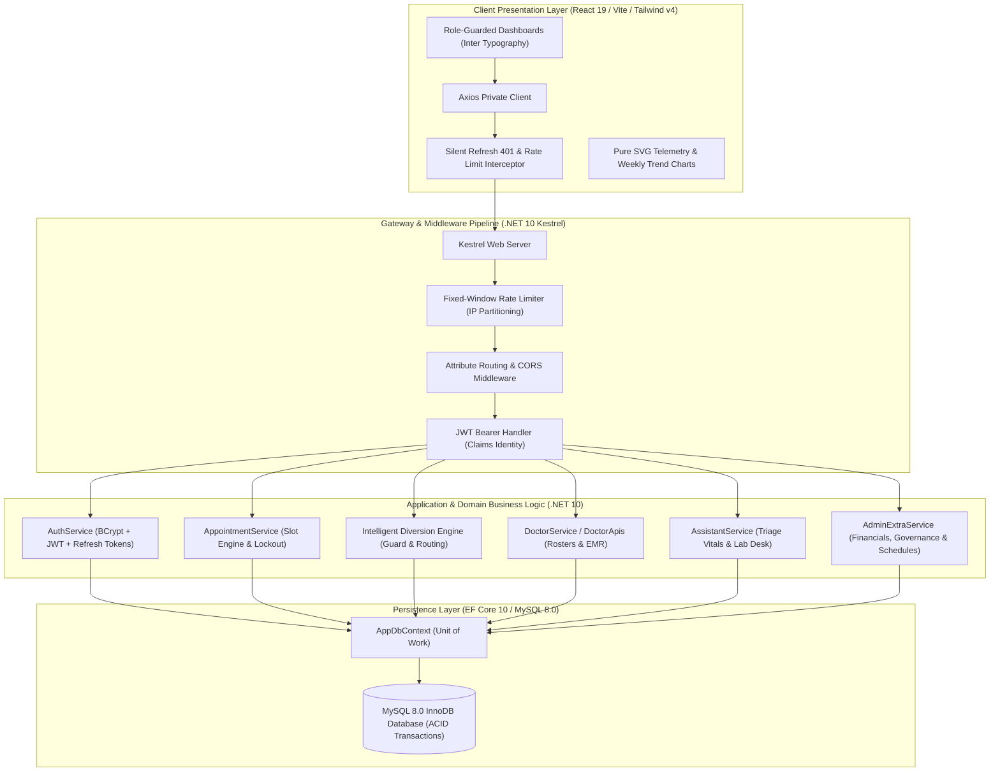
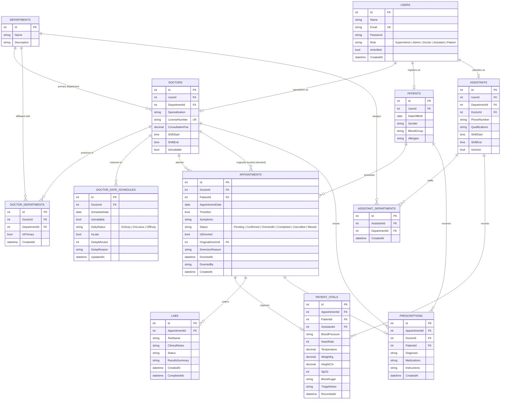

# CareFlow: Enterprise Hospital Management and Clinical Consultation Platform

CareFlow is a full-stack, enterprise-grade Hospital Management System (HMS) and Clinical Consultation Platform engineered with ASP.NET Core 10 Web API and React 19. Designed for modern healthcare networks, multi-department polyclinics, and high-volume outpatient departments (OPD), CareFlow coordinates physician shift rosters, date-specific scheduling, pre-consultation triage vitals acquisition, diagnostic laboratory workflows, real-time consultation scheduling with multi-user concurrency protection, digital Electronic Medical Records (EMR), active appointment diversion guards, automated patient no-show detection, and hospital operational analytics.

---

## Table of Contents

1. [Architectural Overview](#architectural-overview)
2. [Role-Based Access Control (RBAC) & Key Features](#role-based-access-control-rbac--key-features)
   * [1. SuperAdmin (Institutional Governance)](#1-superadmin-institutional-governance)
   * [2. Administrative Operations (Admin)](#2-administrative-operations-admin)
   * [3. Clinical Provider Portal (Doctor)](#3-clinical-provider-portal-doctor)
   * [4. Clinical Assistant & Triage Desk](#4-clinical-assistant--triage-desk)
   * [5. Patient Care Portal](#5-patient-care-portal)
3. [Engineering Highlights and Edge Case Defenses](#engineering-highlights-and-edge-case-defenses)
   * [1. Intelligent Appointment Diversion Engine & Active Booking Guard](#1-intelligent-appointment-diversion-engine--active-booking-guard)
   * [2. Date-Specific Doctor Schedule & Weekly Roster Architecture](#2-date-specific-doctor-schedule--weekly-roster-architecture)
   * [3. Multi-Department Doctor Affiliation & Clinical Coverage Matrix](#3-multi-department-doctor-affiliation--clinical-coverage-matrix)
   * [4. Department-Centric Clinical Assistant Triage Pooling](#4-department-centric-clinical-assistant-triage-pooling)
   * [5. Real-Time Slot Locking and Concurrency Protection](#5-real-time-slot-locking-and-concurrency-protection)
   * [6. Temporal Parity: Pakistan Standard Time (PKT, UTC+5)](#6-temporal-parity-pakistan-standard-time-pkt-utc5)
   * [7. Idempotent Pre-Consultation Vitals Upsert](#7-idempotent-pre-consultation-vitals-upsert)
   * [8. Post-Consultation Diagnostic Immutability Rule](#8-post-consultation-diagnostic-immutability-rule)
   * [9. Multi-Entity System Activities Aggregation](#9-multi-entity-system-activities-aggregation)
   * [10. Chronological Queue Priority & Instant Consultation Launcher](#10-chronological-queue-priority--instant-consultation-launcher)
   * [11. Rate Limiting & Cryptographic Identity Lifecycle](#11-rate-limiting--cryptographic-identity-lifecycle)
   * [12. Assisted Booking Hotline & Phone Dispatch Architecture](#12-assisted-booking-hotline--phone-dispatch-architecture)
   * [13. Pure SVG Zero-Dependency Visualizations](#13-pure-svg-zero-dependency-visualizations)
   * [14. Strict Institutional Design System & Bounded Sanitation](#14-strict-institutional-design-system--bounded-sanitation)
   * [15. Decoupling Relational Primary Keys from UI (IDOR Defense)](#15-decoupling-relational-primary-keys-from-ui-idor-defense)
4. [Technology Stack](#technology-stack)
5. [Database Architecture & Entity Relationships](#database-architecture--entity-relationships)
6. [Complete API Reference](#complete-api-reference)
   * [Authentication & Security (`/api/Auth`)](#authentication--security-apiauth)
   * [Administration & Governance (`/api/Admin`)](#administration--governance-apiadmin)
   * [Clinical Assistant & Triage Desk (`/api/Assistant`)](#clinical-assistant--triage-desk-apiassistant)
   * [Clinical Provider Operations (`/api/Doctor`)](#clinical-provider-operations-apidoctor)
   * [Public Consultations & Scheduling (`/api/Appointment`)](#public-consultations--scheduling-apiappointment)
   * [Patient Operations (`/api/Patient`)](#patient-operations-apipatient)
   * [Department Management (`/api/Department`)](#department-management-apidepartment)
7. [Getting Started and Local Setup](#getting-started-and-local-setup)
8. [Directory Structure](#directory-structure)
9. [License](#license)

---

## Architectural Overview

CareFlow is engineered on an N-Tier Layered Architecture with strict separation of concerns, dependency injection, and centralized JWT authentication with automatic silent refresh via private Axios interceptors.



---

## Role-Based Access Control (RBAC) & Key Features

CareFlow strictly partitions access across five distinct institutional personas:

```
[SuperAdmin] ──> Institutional Governance & Administrator Provisioning
       └──> [Admin] ──> Operational Roster, Staff Management, Leave & Future Diversions
              ├──> [Doctor] ──> Weekly Shifts, EMR Consultation, Diagnostics & Digital Rx
              ├──> [Assistant] ──> Walk-In Intake, Vitals Triage & Same-Day Diversions
              └──> [Patient] ──> Public Profiles, Slot Booking, Telehealth Ledger & Labs
```

### 1. SuperAdmin (Institutional Governance)
* **Exclusive Administrator Provisioning:** Sole authority capable of registering new hospital administrators (`POST /api/Admin/register-admin`).
* **Two-Step Cryptographic OTP Verification:** Newly registered administrators must be activated through a secure one-time passcode verification flow (`POST /api/Admin/verify-admin-otp`).
* **Governance Console (`AdminGovernance.jsx`):** Audit active administrators, track onboarding timestamps, issue credentials, and manage administrative privileges.

### 2. Administrative Operations (Admin)
* **Financial & Capacity Telemetry:** Real-time metrics on daily hospital revenue, active consultations, doctor roster status, and department bed allocation.
* **Rolling Weekly Trend Visualizer:** Pure SVG bar chart rendering 7-day completed consultation volumes without external dependencies.
* **Specialist Credentialing:** Account verification, license validation, primary and multi-department assignments, and on-demand duty activation.
* **Date-Specific Schedule Roster (`AdminSchedules.jsx`):** Calendar-aware shift roster (`DoctorDateSchedule`) allowing per-day shift timing adjustments and on-duty/off-duty overrides.
* **Active Booking Guard Modal:** Intercepts physician leave requests and off-duty toggles if active bookings exist, forcing administrators to divert future consultations (`Tomorrow and beyond`) before leave can be granted.
* **Clinical Assistant Management:** Onboard, assign, and manage triage staff with multi-department pooling.
* **Unified System Activities Audit:** Real-time chronological audit trail aggregating appointment creations, triage recordings, lab orders, finalized findings, and staff onboarding.

### 3. Clinical Provider Portal (Doctor)
* **Weekly Schedule & Shift Console (`DoctorSchedule.jsx`):** Direct visibility into weekly clinical duty rosters, assigned shifts, primary and secondary departments, and operational status.
* **Delay & Operational Status Reporting:** Report clinical delays (`IsLate`, `DelayMinutes`, `DelayReason`) directly from the portal, alerting triage assistants in real time.
* **Single-Screen Clinical Console:** Integrated shift schedule, queue summary with Checked-In priority, and longitudinal consultation records.
* **Instant 1-Click Consultation Launcher:** Direct consultation launch for patients marked `CheckedIn` by the triage station.
* **Pre-Consultation Vitals Review:** Automatic pre-load of nurse-captured physiological parameters (BP, Pulse, SpO2, Temperature, Blood Sugar, BMI) inside the consultation modal.
* **Digital EMR Prescription Writer:** Comprehensive prescription composer capturing primary diagnoses, medications, dosages, duration, and follow-up directives.
* **Diagnostic Lab Ordering:** Prescribe pathology panels (CBC, LFT, RFT, Lipid Profile, X-Ray) with specialized clinical notes for the laboratory desk.
* **Longitudinal Patient Pathology Archive:** Direct access to past laboratory diagnostic tests and analyzer findings across all previous visits.

### 4. Clinical Assistant & Triage Desk
* **OPD Patient Queue & Check-In:** View today's scheduled consultations scoped by assigned doctor or department, with instant physical arrival check-in.
* **Same-Day Appointment Diversion:** In the event of physician delay, emergency surgery, or unexpected leave, triage assistants can consult the patient and divert today's queue (`AppointmentDate == Today`) to an available peer doctor in the same department or reschedule to a later free slot with the same doctor.
* **Assisted Booking & Walk-In Intake:** Schedule consultations directly on behalf of illiterate, elderly, or phone-in patients (`POST /api/Assistant/book-appointment`). Unifies repeat patient charts via phone deduplication or auto-provisions verified patient identities without requiring user self-registration.
* **Pre-Consultation Vitals Capture:** Record multi-parameter physiological vitals with real-time clinical warnings (Hypertension alerts, Fever indicators, Hypoxemia warnings).
* **Idempotent Re-Measurement:** Seamlessly re-take and update patient vitals to resolve White Coat Hypertension without constraint collisions.
* **Diagnostic Lab Desk:** Manage specimen collection (Blood, Urine, Swab) and enter finalized quantitative laboratory results.
* **Tamper-Evident State Lock:** Diagnostic orders and vitals for completed or past consultations are locked authoritatively against modification.

### 5. Patient Care Portal
* **Physician Discovery & Clinical Profile:** Browse certified specialists by medical department, clinical focus, experience, and consultation fees.
* **Live Shift Slot Selector:** Dynamic time picker displaying accessible consultation windows while immediately disabling occupied or past slots.
* **Appointment Management Ledger:** Filter personal ledger by status (`Pending`, `Confirmed`, `CheckedIn`, `Completed`, `Cancelled`, `Missed`).
* **Automated No-Show Detection:** Consultations where the time slot has elapsed without check-in are automatically projected as `Missed`.
* **Digital Prescription & Lab Archive:** View and download issued EMR prescriptions and finalized diagnostic laboratory reports.
* **Self-Service Cancellation:** Cancel pending or confirmed bookings, immediately releasing the slot back into the public scheduling pool.

---

## Engineering Highlights and Edge Case Defenses

### 1. Intelligent Appointment Diversion Engine & Active Booking Guard
* **The Clinical Vulnerability:** When a physician is granted leave, marked off-duty, or delayed by an emergency surgery, patients who already booked consultations are stranded. Abrupt cancellations damage patient trust and hospital clinical continuity.
* **The Solution — Granular Two-Tier Diversion Architecture:**
  1. **Assistant-Level Same-Day Diversion (`POST /api/Assistant/divert-appointment`):**
     * Scoped strictly to **today's appointments** (`AppointmentDate == TodayInPKT`).
     * When a doctor is delayed, the triage assistant consults the waiting patient and evaluates options via `/api/Assistant/diversion/candidates/{appointmentId}`:
       * **Option A (Peer Doctor Diversion):** Reassign the consultation to an on-duty peer physician within the assistant's clinical department who has an open slot at that time.
       * **Option B (Same Doctor Re-slotting):** Shift the consultation to a later open slot on the same day when the doctor's delay resolves.
  2. **Admin-Level Future Diversion (`POST /api/Admin/divert-appointment`):**
     * Scoped to **tomorrow and subsequent calendar dates** (`AppointmentDate > TodayInPKT`).
     * Administrators handle advance schedule disruptions and reallocate appointments across departmental peers.
  3. **Active Booking Guard Modal:**
     * Attempting to mark a doctor off-duty or assign leave via `AdminSchedules.jsx` triggers a pre-flight query (`GET /api/Admin/doctor/{id}/appointments?date={date}`).
     * If active appointments (`Pending`, `Confirmed`, `CheckedIn`) exist, the toggle is intercepted by the **Active Appointments Detected Guard Modal**.
     * Administrators must review candidate peer doctors and divert or reschedule every active booking before leave is finalized, ensuring zero orphaned appointments.
  4. **Forensic Audit Traceability on Entity:**
     * Every diverted consultation is permanently flagged with `IsDiverted = true`, storing `OriginalDoctorId`, `DiversionReason`, `DivertedAt`, and `DivertedBy` for legal and clinical auditing.

### 2. Date-Specific Doctor Schedule & Weekly Roster Architecture
* Standard hospital management systems rely on static recurring shift columns on the `Doctor` entity (`ShiftStart`, `ShiftEnd`), making it impossible to handle planned leaves, temporary schedule swaps, or day-specific shifts.
* CareFlow introduces `DoctorDateSchedule`:
  * Enables granular, date-specific shift timings and duty statuses (`OnDuty`, `OnLeave`, `OffDuty`).
  * Tracks operational delays with `IsLate`, `DelayMinutes`, and `DelayReason`.
  * Preserves default doctor shift templates while permitting seamless calendar-specific overrides.
  * Dedicated Weekly Roster view in both Admin (`AdminSchedules.jsx`) and Doctor (`DoctorSchedule.jsx`) portals.

### 3. Multi-Department Doctor Affiliation & Clinical Coverage Matrix
* Many senior consultants practice across multiple specialties (e.g., an Interventional Cardiologist also consulting in Internal Medicine, or a Pediatric Surgeon consulting in General Surgery).
* CareFlow decouples physicians from single foreign keys via the `DoctorDepartment` join entity:
  * Each physician has a designated **Primary Department** (`IsPrimary = true`) alongside authorized **Secondary Departmental Affiliations**.
  * Managed via `PATCH /api/Admin/doctor/{id}/departments`.
  * Public portal physician filters, triage queues, and diversion engines automatically respect cross-department qualifications while preventing cross-specialty clinical mismatches.

### 4. Department-Centric Clinical Assistant Triage Pooling
* Traditional systems couple each assistant directly to a single physician. If that doctor is off-duty, the assistant is idle while other clinic queues overflow.
* CareFlow implements departmental assistant pooling via `AssistantDepartment`:
  * Assistants are assigned to clinical departments (e.g., Cardiology OPD, Orthopedics Desk), allowing them to manage triage, check-in, vitals, and phone intake for all doctors within their assigned department.

### 5. Real-Time Slot Locking and Concurrency Protection
* **The Vulnerability:** Multiple patients attempting to reserve the identical time slot concurrently, or reserving a slot that is currently in a `Pending` state awaiting physician confirmation.
* **The Solution:** The backend query `GetBookedSlots` evaluates all slots where `(Status == "Confirmed" || Status == "Pending" || Status == "Completed")`.
* **Database Isolation:** When two patients submit a booking request for the identical slot at the same millisecond:
  * Thread 1 acquires the transactional write lock, commits the row with `Status = "Pending"`, and returns `HTTP 201 Created`.
  * Thread 2's `AnyAsync` validation catches the committed row, aborts the insert, and throws a `DuplicateNameException`.
  * The API responds with `HTTP 400 Bad Request` (`"This Time slot is already Booked"`).
  * The frontend client intercepts the error, renders an alert notification, and immediately refetches `/api/Appointment/booked-slots`, visibly disabling the occupied slot on screen.

### 6. Temporal Parity: Pakistan Standard Time (PKT, UTC+5)
* Server clocks running on UTC frequently corrupt boundary dates during late night hours (for example, 02:00 AM PKT is 09:00 PM UTC of the previous calendar day).
* CareFlow standardizes all operational timestamps to **Pakistan Standard Time (PKT, UTC+5)** across:
  * **Server Service Layer:** `DateTime.UtcNow.AddHours(5)` across revenue sums, audit timestamps, OPD queues, schedule rosters, and daily metrics.
  * **Frontend Client:** `Intl.DateTimeFormat('en-CA', { timeZone: 'Asia/Karachi' })` ensuring timezone consistency regardless of client location.

### 7. Idempotent Pre-Consultation Vitals Upsert
* Patients frequently experience elevated blood pressure upon initial hospital arrival ("White Coat Hypertension"). Triage nurses instruct patients to rest and take a second reading 15 minutes later.
* `AssistantService.RecordVitals` checks for an existing record on `AppointmentId`. If present, it updates the row in-place rather than attempting a duplicate `INSERT`, avoiding MySQL unique constraint collisions on `IX_PatientVitals_AppointmentId`.

### 8. Post-Consultation Diagnostic Immutability Rule
* Once a doctor completes an examination and issues the prescription, clinical and legal standards mandate that diagnostic orders become immutable.
* Both `CreateLabOrder` and `UpdateLabOrderStatus` in `AssistantService.cs` enforce `if (appointment.Status == "Completed") throw new InvalidOperationException(...)`.
* The DTO projects `IsAppointmentCompleted` and `AppointmentStatus`, dynamically locking frontend buttons in `AssistantLabDesk.jsx` to render `"Locked (Completed)"`.

### 9. Multi-Entity System Activities Aggregation
* Operational audit requirements demand that the administrative dashboard displays all clinical actions across roles.
* `AdminExtraService.cs` aggregates five asynchronous event streams into `RecentActivities`:
  1. Appointment bookings, diversions, and confirmations
  2. Patient triage vitals recordings
  3. Pathology lab tests ordered
  4. Finalized laboratory test findings
  5. Assistant staff registrations
* The aggregated stream is projected into a unified schema and sorted descending by timestamp.

### 10. Chronological Queue Priority & Instant Consultation Launcher
* In high-volume outpatient clinics, walk-ins, emergency additions, and newly checked-in patients must appear at the top of the queue.
* All queries across Doctor, Assistant, and Patient dashboards enforce `.OrderByDescending(a => a.AppointmentDate).ThenByDescending(a => a.TimeSlot).ThenByDescending(a => a.Id)`.
* When a patient is checked in at triage, their status updates to `CheckedIn`, displaying an instant **Start Consultation** trigger on the attending doctor's dashboard.

### 11. Rate Limiting & Cryptographic Identity Lifecycle
* **Rate Limiting:** ASP.NET Core `FixedWindowRateLimiter` configured with IP partitioning protects authentication endpoints (`/api/Auth/login`, `/api/Auth/patient/register`, `/api/Auth/resend-otp`, `/api/Auth/forgot-password`) against automated brute-force and credential-stuffing attacks.
* **Tokenized Email Verification:** Token-based verification (`/api/Auth/patient/verify-email`, `VerifyEmail.jsx`, `ResendMail.jsx`) ensures patient email validity before full platform access.
* **Silent Refresh & Revocation:** Dual-token JWT architecture with cryptographic refresh tokens stored in secure, HttpOnly, SameSite cookies. Supports granular single-session logout (`/api/Auth/logout`) and enterprise-wide revocation (`/api/Auth/logout-all`).

### 12. Assisted Booking Hotline & Phone Dispatch Architecture
* **The Reality:** A large demographic of hospital patients, especially the elderly, rural visitors, and non-tech-savvy individuals, cannot self-register online accounts.
* **The Solution:** Clinical assistants act as digital dispatchers equipped with direct phone lines:
  * **Institutional Hotline & Physician Cards:** Dedicated `PhoneNumber` hotlines are exposed prominently on the home page (`/`) and directly within each specialist's card (`Call Assistant: [Phone]`).
  * **Composite Multi-Factor MPI Deduplication:** To prevent medical chart overlay corruption when multiple family members share a household phone (e.g., father and son sharing `03001234567`), the engine matches by composite `(PhoneNumber, Name)`. Returning patients reuse their existing longitudinal record, while distinct family members receive dedicated patient charts and unique collision-free synthetic emails (`walkin.{phone}.{name}@careflow.hospital`).
  * **Department-Scoped Scheduling Governance:** Enforces clinical governance where assistants can only schedule appointments for physicians within their assigned clinical department.

### 13. Pure SVG Zero-Dependency Visualizations
* **Donut Chart:** Built using mathematical circle circumference geometry ($C = 2\pi r$), dynamic `strokeDasharray`, and cumulative `strokeDashoffset` rotations.
* **Weekly Bar Chart:** Built using pure SVG `<rect>` elements normalized dynamically against `Math.max(...completedCount, 1)` within a responsive `<svg viewBox="0 0 500 200">` canvas.

### 14. Strict Institutional Design System & Bounded Sanitation
* **Universal Typography:** Enforced the `Inter` font globally across all HTML tags, form controls, inputs, and buttons.
* **Bounded Input Sanitation:** Mandatory boundary guards are enforced across all form inputs (names $\le 50$, search queries $\le 100$, medical license $\le 30$, lab notes $\le 300$, prescription advice $\le 1500$, telephone numbers $\le 15$).
* **Scrollbar Optimization:** Implemented `.scrollbar-none` to eliminate horizontal scrollbar tracks on Windows Chromium while preserving scrolling behavior.

### 15. Decoupling Relational Primary Keys from UI (IDOR Defense)
* Raw database primary keys (e.g., `#PID-14`, `ID: #14`, `#CF-02`, `#RX-3800`) were expunged from the presentation layer to defend against OWASP Insecure Direct Object Reference (IDOR) and business volume harvesting attacks.
* Medical staff reference queues using intuitive, volatile sequential serial numbers (`#1`, `#2`, `#3`) that decouple front-end presentation from MySQL relational schemas.

---

## Technology Stack

### Backend
| Technology | Version | Purpose |
| :--- | :--- | :--- |
| **ASP.NET Core Web API** | 10.0 | High-performance enterprise REST API framework |
| **C#** | 13.0 | Modern language features (Pattern matching, records, primary constructors, null safety) |
| **Entity Framework Core** | 10.0 | ORM and data access layer with LINQ expressions |
| **Pomelo.EntityFrameworkCore.MySql** | 9.0 | High-throughput MySQL database connector |
| **BCrypt.Net-Next** | 4.0.3 | Salted cryptographic password hashing |
| **System.IdentityModel.Tokens.Jwt** | 8.x | Cryptographic JWT token generation and validation |
| **System.Threading.RateLimiting** | 10.0 | IP-partitioned fixed-window rate limiting middleware |

### Frontend
| Technology | Version | Purpose |
| :--- | :--- | :--- |
| **React** | 19.0 | Concurrent React component rendering engine |
| **Vite** | 6.0 | Sub-second HMR build tooling and asset bundler |
| **Tailwind CSS** | 4.0 | Utility-first responsive design framework |
| **React Router** | 7.x | Client-side routing with guarded RBAC route wrappers |
| **Axios** | 1.8 | HTTP client configured with request & 401 silent refresh response interceptors |
| **Lucide React** | 1.16 | High-contrast clinical and institutional iconography |

---

## Database Architecture & Entity Relationships



---

## Complete API Reference

### Authentication & Security (`/api/Auth`)
*Protected by IP-partitioned rate limiting middleware (`[EnableRateLimiting("auth")]`).*

| Method | Route | Access | Description |
| :--- | :--- | :--- | :--- |
| `POST` | `/api/Auth/patient/register` | Public | Register a new patient account with credentials |
| `POST` | `/api/Auth/patient/verify-email` | Public | Verify patient account via cryptographic email token |
| `POST` | `/api/Auth/login` | Public | Authenticate user; returns Access Token and sets HttpOnly Refresh Token cookie |
| `POST` | `/api/Auth/refresh-token` | Public | Silent refresh: exchanges valid refresh token cookie for new access token |
| `POST` | `/api/Auth/logout` | Public | Invalidate current user refresh session and clear cookie |
| `POST` | `/api/Auth/logout-all` | Public | Invalidate all active user sessions across all devices |
| `POST` | `/api/Auth/resend-otp` | Public | Resend email verification passcode to unverified account |
| `POST` | `/api/Auth/forgot-password` | Public | Dispatch password reset token to registered email |
| `POST` | `/api/Auth/reset-password` | Public | Validate reset token and establish new salted password |

---

### Administration & Governance (`/api/Admin`)

| Method | Route | Access | Description |
| :--- | :--- | :--- | :--- |
| `POST` | `/api/Admin/register-admin` | **SuperAdmin** | Onboard a new hospital administrator (triggers OTP verification) |
| `POST` | `/api/Admin/verify-admin-otp` | **SuperAdmin** | Validate administrator onboarding OTP and activate administrative account |
| `GET` | `/api/Admin/admins-list` | **SuperAdmin** | Retrieve list of all registered administrators and verification states |
| `POST` | `/api/Admin` | SuperAdmin, Admin | Register and credential a new physician |
| `GET` | `/api/Admin/admin` | SuperAdmin, Admin | Retrieve administrative listing of all doctors with credentials and shifts |
| `GET` | `/api/Admin` | Public | Query verified physicians for public directory |
| `GET` | `/api/Admin/doctor/{id}` | Public | Retrieve public physician clinical profile and fees |
| `GET` | `/api/Admin/dashboard` | SuperAdmin, Admin | Operational telemetry: daily revenue sums, active consultations, 7-day trend |
| `GET` | `/api/Admin/patient` | SuperAdmin, Admin | Retrieve registered patient master ledger |
| `GET` | `/api/Admin/audit-logs` | SuperAdmin, Admin | Aggregated system audit activity stream sorted descending |
| `GET` | `/api/Admin/schedules` | SuperAdmin, Admin | Query calendar-aware schedule roster (`DoctorDateSchedule`) by date |
| `PATCH`| `/api/Admin/doctor/{id}/shift` | SuperAdmin, Admin | Update doctor shift hours for default template or specific calendar date |
| `PATCH`| `/api/Admin/doctor/{id}/availability` | SuperAdmin, Admin | Toggle doctor on-duty/off-duty (intercepted if active bookings exist) |
| `PATCH`| `/api/Admin/doctor/{id}/departments` | SuperAdmin, Admin | Update doctor primary and secondary clinical department affiliations |
| `GET` | `/api/Admin/diversion/candidates/{appointmentId}` | SuperAdmin, Admin | Retrieve candidate peer doctors and free slots for future diversion |
| `POST` | `/api/Admin/divert-appointment` | SuperAdmin, Admin | Execute future consultation diversion (`AppointmentDate > Today`) |
| `GET` | `/api/Admin/doctor/{doctorId}/appointments` | SuperAdmin, Admin | Pre-flight query: check active appointments for doctor on specific date |

---

### Clinical Assistant & Triage Desk (`/api/Assistant`)

| Method | Route | Access | Description |
| :--- | :--- | :--- | :--- |
| `GET` | `/api/Assistant/queue` | Assistant, SuperAdmin, Admin | Today's OPD patient queue in PKT, ordered descending |
| `PATCH`| `/api/Assistant/check-in/{appointmentId}` | Assistant, SuperAdmin, Admin | Mark physical arrival of patient at triage desk (`CheckedIn`) |
| `POST` | `/api/Assistant/book-appointment` | Assistant, SuperAdmin, Admin | Assisted intake for phone/walk-in patients with automatic deduplication |
| `GET` | `/api/Assistant/schedulable-doctors` | Assistant, SuperAdmin, Admin | Retrieve authorized specialists within assistant's assigned department |
| `GET` | `/api/Assistant/department-doctors` | Assistant, SuperAdmin, Admin | List all physicians assigned to the assistant's clinical department |
| `GET` | `/api/Assistant/diversion/candidates/{appointmentId}` | Assistant, SuperAdmin, Admin | Retrieve same-day diversion candidates (peer doctors & same-doctor slots) |
| `POST` | `/api/Assistant/divert-appointment` | Assistant, SuperAdmin, Admin | Execute same-day appointment diversion (`AppointmentDate == Today`) |
| `POST` | `/api/Assistant/vitals` | Assistant, SuperAdmin, Admin | Record or idempotently update pre-consultation triage vitals |
| `GET` | `/api/Assistant/vitals/{appointmentId}` | Assistant, Doctor, Admin | Retrieve recorded triage vitals for consultation |
| `POST` | `/api/Assistant/lab-order` | Doctor, SuperAdmin, Admin | Prescribe a diagnostic laboratory panel |
| `GET` | `/api/Assistant/lab-orders/{appointmentId}` | Assistant, Doctor, Patient, Admin | Retrieve lab orders associated with an appointment |
| `GET` | `/api/Assistant/pending-lab-orders` | Assistant, SuperAdmin, Admin | Laboratory desk queue for pending specimens and results |
| `PUT` | `/api/Assistant/lab-order/{id}/status` | Assistant, Doctor, Admin | Update specimen collection state and record finalized findings |
| `GET` | `/api/Assistant/patient-lab-history/{patientId}` | Doctor, Assistant, Admin | Longitudinal pathology archive across all historical patient visits |
| `POST` | `/api/Assistant/register` | SuperAdmin, Admin | Register and onboard a new clinical assistant |
| `GET` | `/api/Assistant/all` | SuperAdmin, Admin | List all registered clinical assistants with shift assignments |
| `PUT` | `/api/Assistant/{id}` | SuperAdmin, Admin | Update assistant shift, department, doctor assignment, or active status |
| `DELETE`| `/api/Assistant/{id}` | SuperAdmin, Admin | Delete assistant profile (restricted if triage history exists) |
| `GET` | `/api/Assistant/my-assistants` | Doctor | Retrieve assistants assigned to the calling physician |

---

### Clinical Provider Operations (`/api/Doctor`)

| Method | Route | Access | Description |
| :--- | :--- | :--- | :--- |
| `GET` | `/api/Doctor/doctor-dashboard` | Doctor | Telemetry: today's consultations, checked-in count, completed count |
| `GET` | `/api/Doctor/doctor-appointments` | Doctor | Retrieve physician consultation roster in descending order |
| `PATCH`| `/api/Doctor/appointment-status` | Doctor | Transition consultation state (`Confirmed`, `Missed`) |
| `POST` | `/api/Doctor/prescription` | Doctor | Issue digital EMR prescription and mark consultation `Completed` |
| `GET` | `/api/Doctor/medical-history/{patientId}` | Doctor | View patient longitudinal medical, vitals, and diagnostic history |
| `GET` | `/api/Doctor/my-schedule` | Doctor | Retrieve weekly date-specific schedule, shift timings, and department matrix |
| `GET` | `/api/Doctor/daily-status` | Doctor | Retrieve today's operational duty status, delay minutes, and delay reason |
| `POST` | `/api/Doctor/daily-status` | Doctor | Set today's operational duty status and broadcast clinical delay |

---

### Public Consultations & Scheduling (`/api/Appointment`)

| Method | Route | Access | Description |
| :--- | :--- | :--- | :--- |
| `GET` | `/api/Appointment/availability` | Public | Query verified physicians by department, date, and time slot |
| `GET` | `/api/Appointment/booked-slots` | Public | Retrieve occupied shift slots for a doctor on a specific date |
| `POST` | `/api/Appointment/booking` | Patient | Submit consultation booking with transactional concurrency protection |

---

### Patient Operations (`/api/Patient`)

| Method | Route | Access | Description |
| :--- | :--- | :--- | :--- |
| `GET` | `/api/Patient/my-appointment` | Patient | View scheduled personal consultations (auto-classifies missed appointments) |
| `GET` | `/api/Patient/prescription` | Patient | Access and download issued digital prescriptions |
| `PATCH`| `/api/Patient/cancel-appointment/{id}` | Patient | Cancel pending or confirmed booking, immediately freeing the slot |
| `GET` | `/api/Patient/profile` | Patient | Retrieve patient profile, blood group, and emergency demographics |
| `PATCH`| `/api/Patient/profile` | Patient | Update personal medical profile and allergy history |

---

### Department Management (`/api/Department`)

| Method | Route | Access | Description |
| :--- | :--- | :--- | :--- |
| `GET` | `/api/Department` | Public | Retrieve all clinical departments |
| `POST` | `/api/Department` | SuperAdmin, Admin | Register a new hospital clinical department |

---

## Getting Started and Local Setup

### Prerequisites
* **.NET 10 SDK**
* **Node.js** (v20.x or higher)
* **MySQL Server** (v8.0 or higher)

### 1. Database Configuration
1. Ensure your local MySQL instance is running.
2. In `backend/appsettings.json`, configure your connection string and JWT credentials:
   ```json
   {
     "ConnectionStrings": {
       "DefaultConnection": "Server=localhost;Port=3306;Database=hospital;User=root;Password=YOUR_PASSWORD;"
     },
     "Jwt": {
       "Key": "YOUR_STRONG_SECRET_KEY_MIN_32_CHARACTERS",
       "Issuer": "CareFlowServer",
       "Audience": "CareFlowClient",
       "DurationMinutes": 60
     }
   }
   ```

### 2. Backend Initialization
```bash
cd backend

# Restore NuGet dependencies
dotnet restore

# Build solution
dotnet build

# Apply database migrations
dotnet ef database update

# Launch Web API server (Runs on http://localhost:5282)
dotnet run
```

### 3. Frontend Initialization
```bash
cd frontend

# Install dependencies
npm install

# Start Vite development server (Runs on http://localhost:5173)
npm run dev
```

---

## Directory Structure

```
Hospital Management System/
├── backend/
│   ├── Controllers/             # REST API Controllers
│   │   ├── AdminControllers.cs       # SuperAdmin Governance, Doctor Credentials, Roster & Diversion
│   │   ├── AppointmentControllers.cs # Public Availability & Concurrency Slot Booking
│   │   ├── AssistantController.cs    # Triage Queue, Vitals, Lab Desk & Same-Day Diversion
│   │   ├── AuthControllers.cs       # Rate-Limited Auth, Tokens, Email Verification & Password Reset
│   │   ├── DepartmentController.cs   # Clinical Departments Management
│   │   ├── DoctorController.cs       # Doctor Console, EMR Prescriptions, History & Weekly Schedule
│   │   └── PatientController.cs      # Patient Bookings, Prescriptions, History & Profile
│   ├── Data/                    # EF Core AppDbContext & Database Configurations
│   ├── DTOs/                    # Request & Response Data Transfer Objects
│   │   ├── AdminDto.cs               # Governance, Schedule Rosters & Diversion DTOs
│   │   ├── AssistantDtos.cs          # Triage, Vitals, Lab Desk & Diversion DTOs
│   │   ├── AuthDtos.cs               # Registration, Login, Token & Password DTOs
│   │   └── DoctorDto.cs              # EMR Prescriptions, Schedule & Status DTOs
│   ├── Interfaces/              # Business Service Contracts (IAdminExtra, IAssistant, IDoctorApis, etc.)
│   ├── Migrations/              # Entity Framework Database Migrations
│   ├── Models/                  # Domain Entities
│   │   ├── Appointment.cs            # Consultations with Forensic Diversion Audit Columns
│   │   ├── Assistant.cs              # Triage Nurse Staff Entity
│   │   ├── AssistantDepartment.cs    # Departmental Assistant Pooling Join Entity
│   │   ├── Departments.cs            # Clinical Specialty Departments
│   │   ├── Doctor.cs                 # Certified Physician Profile
│   │   ├── DoctorDateSchedule.cs     # Date-Specific Calendar Schedules & Operational Status
│   │   ├── DoctorDepartment.cs       # Multi-Department Affiliation Join Entity
│   │   ├── Labs.cs                   # Diagnostic Pathology Orders & Findings
│   │   ├── Patient.cs                # Patient Demographic Profile
│   │   ├── PatientVitals.cs          # Physiological Parameters (BP, Pulse, SpO2, Temp, Sugar)
│   │   ├── Prescriptions.cs          # Digital EMR Prescriptions
│   │   └── User.cs                   # Central Identity Entity with 5-Tier RBAC Roles
│   ├── Services/                # Core Business Logic & Domain Services
│   │   ├── AdminExtraService.cs      # Telemetry, Governance, Schedules & Future Diversion Engine
│   │   ├── AppointmentService.cs     # Real-Time Slot Locking & Concurrency Protection
│   │   ├── AssistantService.cs       # Triage Desk, Vitals, Labs & Same-Day Diversion Engine
│   │   ├── AuthService.cs            # BCrypt Hashing, JWT Minting & Refresh Token Lifecycle
│   │   └── DoctorApis.cs / DoctorService.cs # EMR Prescriptions, History & Daily Status
│   ├── appsettings.json         # Database & JWT Configuration
│   └── Program.cs               # Middleware Pipeline, Rate Limiter & DI Registration
│
├── frontend/
│   ├── src/
│   │   ├── api/                 # Axios Base Instance & Public Clients
│   │   ├── components/          # Reusable UI Elements (Modals, Pagination, ProtectedRoutes, GuestRoute)
│   │   ├── context/             # Global AuthContext & Role Hydration
│   │   ├── hooks/               # Custom Hooks (useAuth, useAxiosPrivate)
│   │   ├── Pages/
│   │   │   ├── Admin/           # Admin Analytics, Governance, Schedules, Doctors, Assistants
│   │   │   │   ├── AdminGovernance.jsx # SuperAdmin Console: Onboard Admins & OTP Verification
│   │   │   │   ├── AdminSchedules.jsx  # Weekly Schedule Roster & Active Booking Guard Modal
│   │   │   │   ├── AdminOverview.jsx   # Financial KPI Telemetry & SVG 7-Day Trend Chart
│   │   │   │   ├── AdminDoctors.jsx    # Specialist Credentialing & Department Matrix
│   │   │   │   └── AdminAssistants.jsx # Triage Staff Management & Pool Assignment
│   │   │   ├── Doctor/          # Clinical Overview, Appointments, EHR, Prescriptions, Schedule
│   │   │   │   ├── DoctorSchedule.jsx  # Doctor Weekly Schedule & Delay Reporting
│   │   │   │   ├── DoctorOverview.jsx  # Single-Screen Clinical Console
│   │   │   │   └── DoctorAppointments.jsx # Patient Queue & 1-Click Consultation Launcher
│   │   │   ├── Assistant/       # Triage Queue, Vitals Capture, Lab Desk, Walk-In Intake
│   │   │   │   ├── AssistantTriageQueue.jsx # OPD Queue, Check-In, Vitals & Same-Day Diversion
│   │   │   │   └── AssistantLabDesk.jsx     # Specimen Collection & Results Reporting
│   │   │   ├── Patient/         # Patient Dashboard, Booking Flow, History, Prescriptions
│   │   │   ├── DoctorPublicProfile.jsx      # Public Specialist Profile & Live Slot Selector
│   │   │   ├── VerifyEmail.jsx              # Token-Based Email Verification
│   │   │   ├── ResendMail.jsx               # Passcode Re-dispatch Portal
│   │   │   └── Login.jsx / Register.jsx     # Authentication Portals
│   │   ├── App.jsx              # Application Route Registry with Strict RBAC Wrappers
│   │   ├── index.css            # Global Typography (Inter), Utilities (.scrollbar-none)
│   │   └── main.jsx             # React Application Entry Point
│   ├── package.json
│   └── vite.config.js
│
└── README.md                    # Root System Architecture & Documentation
```

---

## License
This project is licensed under the MIT License. See the LICENSE file for details.
