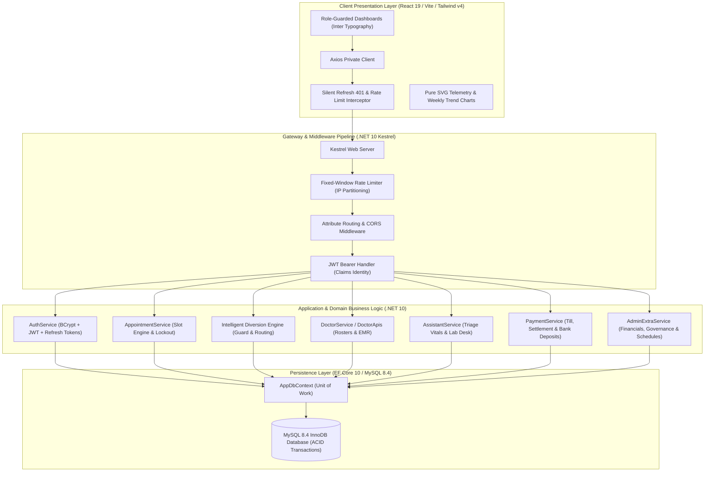
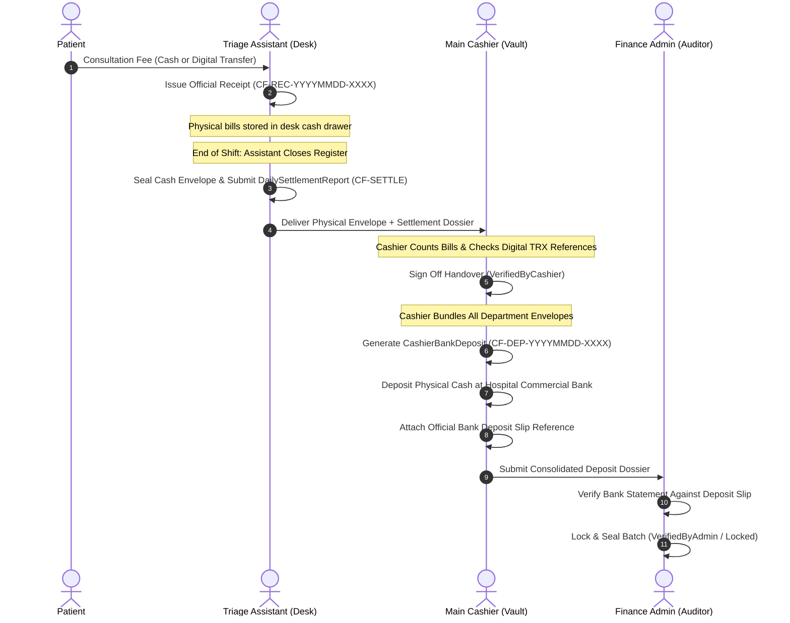
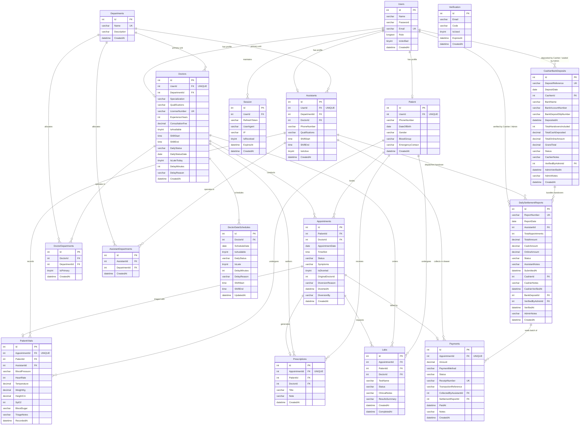

# CareFlow: Enterprise Hospital Management & Clinical Operations Platform

[](https://dotnet.microsoft.com/)
[](https://react.dev/)
[](https://tailwindcss.com/)
[](https://www.mysql.com/)
[](https://aws.amazon.com/ec2/)
[](LICENSE)

CareFlow is a full-stack, enterprise-grade Hospital Management System (HMS), Clinical Operations Engine, and Multi-Tier Financial Treasury Platform engineered with **ASP.NET Core 10 Web API** and **React 19**. 

Architected for multi-department healthcare networks and high-throughput outpatient clinics (OPD), CareFlow coordinates physician shift rosters, pre-consultation triage vitals, diagnostic pathology requisitions, real-time consultation scheduling with multi-user concurrency protection, digital Electronic Medical Records (EMR), active appointment diversion guards, automated patient no-show detection, and a **four-tier hospital cash reconciliation and commercial bank deposit pipeline**.

---

## Live Demo Credentials & Testing Matrix

For evaluators, recruiters, and auditors reviewing CareFlow's role-based workflows, the platform provides dedicated pre-configured test personas across all clinical, administrative, and treasury tiers:

| Role | Demo Email | Demo Password | Primary Operational Scope |
| :--- | :--- | :--- | :--- |
| 👑 **SuperAdmin / Admin** | `admin@careflow.com` | `Password123!` | Executive Governance, Staff Credentialing, Roster Matrix, Settlement Auditing & Final Sealing |
| 🩺 **Doctor (Physician)** | `dr.farhan@careflow.com` | `Password123!` | OPD Clinical Console, Patient Encounter Queue, Vital Sign Review, EMR Prescriptions & Lab Orders |
| 🩺 **Assistant (Triage Nurse)** | `assistant@careflow.com` | `Password123!` | Walk-in Intake, Triage Vitals Acquisition (BP/Pulse/SpO2), Consultation Fee Collection & Shift Closing Handover |
| 💵 **Main Cashier (Treasury)** | `cashier@careflow.com` | `Password123!` | Multi-Assistant Handover Envelope Verification, Bill Counting, Consolidated Commercial Bank Deposits |
| 👤 **Patient (Care Portal)** | `patient@careflow.com` | `Password123!` | Self-Service Specialist Discovery, Dynamic Slot Picker, Shift Delay Alerts, Prescription History & Invoices |

*Note: All passwords across testing accounts are standardized to `Password123!` for friction-free cross-role evaluation.*

---

## Table of Contents

1. [Architectural Overview](#architectural-overview)
2. [Role-Based Access Control (RBAC) & Portals](#role-based-access-control-rbac--portals)
   * [1. SuperAdmin (Institutional Governance)](#1-superadmin-institutional-governance)
   * [2. Administrative Operations (Admin)](#2-administrative-operations-admin)
   * [3. Clinical Provider Portal (Doctor)](#3-clinical-provider-portal-doctor)
   * [4. Clinical Assistant & Triage Desk](#4-clinical-assistant--triage-desk)
   * [5. Main Cashier & Treasury Desk](#5-main-cashier--treasury-desk)
   * [6. Patient Care Portal](#6-patient-care-portal)
3. [Engineering Highlights & Enterprise Defenses](#engineering-highlights--enterprise-defenses)
   * [1. Four-Tier Cash Reconciliation & Treasury Pipeline](#1-four-tier-cash-reconciliation--treasury-pipeline)
   * [2. AWS Cloud Architecture & Remote Database Resilience](#2-aws-cloud-architecture--remote-database-resilience)
   * [3. Intelligent Appointment Diversion Engine & Active Booking Guard](#3-intelligent-appointment-diversion-engine--active-booking-guard)
   * [4. Date-Specific Doctor Schedule & Weekly Roster Architecture](#4-date-specific-doctor-schedule--weekly-roster-architecture)
   * [5. Multi-Department Doctor Affiliation Matrix](#5-multi-department-doctor-affiliation-matrix)
   * [6. Real-Time Slot Locking & Concurrency Protection](#6-real-time-slot-locking--concurrency-protection)
   * [7. Temporal Parity: Pakistan Standard Time (PKT, UTC+5)](#7-temporal-parity-pakistan-standard-time-pkt-utc5)
   * [8. Idempotent Pre-Consultation Vitals Upsert](#8-idempotent-pre-consultation-vitals-upsert)
   * [9. Post-Consultation Diagnostic Immutability Rule](#9-post-consultation-diagnostic-immutability-rule)
   * [10. Rate Limiting & Cryptographic Identity Lifecycle](#10-rate-limiting--cryptographic-identity-lifecycle)
   * [11. Composite Multi-Factor MPI Deduplication](#11-composite-multi-factor-mpi-deduplication)
   * [12. Decoupling Relational Primary Keys from UI (IDOR Defense)](#12-decoupling-relational-primary-keys-from-ui-idor-defense)
4. [Technology Stack](#technology-stack)
5. [Database Architecture & Complete ER Diagram (18 Tables)](#database-architecture--complete-er-diagram-18-tables)
6. [Complete REST API Reference](#complete-rest-api-reference)
7. [Getting Started & Local Setup](#getting-started--local-setup)
8. [AWS EC2 Production Deployment Guide](#aws-ec2-production-deployment-guide)
9. [Directory Structure](#directory-structure)
10. [License](#license)

---

## Architectural Overview

CareFlow is engineered on an N-Tier Layered Architecture with strict separation of concerns, dependency injection, and centralized JWT authentication with automatic silent refresh via private Axios interceptors.



---

## Role-Based Access Control (RBAC) & Portals

### 1. SuperAdmin (Institutional Governance)
* **Staff Provisioning:** Provision, suspend, and credential secondary Administrative Officers, Clinical Specialists, Triage Assistants, and Main Cashiers.
* **Master Governance Audit:** Inspect system-wide security logs, refresh token revocation events, and institutional activity streams.

### 2. Administrative Operations (Admin)
* **Clinical Department Management:** Add, configure, and manage medical specialties (Cardiology, Neurology, Pediatrics, etc.).
* **Doctor Credentialing & Roster Allocation:** Assign consulting physicians to primary and secondary specialties, configure consultation fees, and schedule weekly shift templates.
* **Active Booking Leave Guard:** Prevent unauthorized doctor schedule deletions when active patient appointments exist.
* **Financial Reconciliation Audit:** Audit daily cash settlement reports submitted by assistants and verified bank deposits uploaded by the Cashier.

### 3. Clinical Provider Portal (Doctor)
* **OPD Clinical Console:** Real-time patient queue sorted chronologically with live status tags (`Pending`, `Confirmed`, `CheckedIn`, `Completed`).
* **Instant Encounter Launcher:** Launch patient consultations with immediate access to pre-consultation triage vitals recorded by nurses.
* **Electronic Medical Records (EMR):** Author diagnoses, prescriptions with pharmacological directives, and diagnostic pathology laboratory orders.
* **Dynamic Delay Broadcast:** Report expected operational delays (e.g., 20 mins due to emergency surgery) with patient notifications.

### 4. Clinical Assistant & Triage Desk
* **Patient Walk-In Intake:** Register on-site patients with composite multi-factor MPI deduplication.
* **Triage Vitals Capture:** Record physiological parameters (Blood Pressure, Heart Rate, Body Temperature, SpO2, Weight, Height, Blood Sugar, Clinical Triage Notes).
* **Consultation Fee Collection (Till):** Process consultation payments (Cash, Card, JazzCash, EasyPaisa, Raast), generating standardized thermal receipts (`CF-REC-YYYYMMDD-XXXX`).
* **Shift Closing Handover:** Seal daily collections into a formal physical cash envelope and submit an immutable `DailySettlementReport` (`CF-SETTLE-YYYYMMDD-ASTXX`).

### 5. Main Cashier & Treasury Desk
* **Assistant Handover Ingestion:** Receive and audit physical cash settlement envelopes delivered by departmental assistants at shift end.
* **Physical Currency Verification:** Verify physical currency count against digital audit logs and mark handovers as `VerifiedByCashier`.
* **Consolidated Bank Deposit Batching:** Group multiple assistant handovers into a single commercial bank deposit dossier (`CF-DEP-YYYYMMDD-XXXX`).
* **Bank Deposit Slip Attachment:** Record the official commercial bank deposit slip number, deposit date, and bank branch details for Admin reconciliation.

### 6. Patient Care Portal
* **Physician Discovery & Clinical Profiles:** Search accredited specialists by specialty, qualifications, experience, and consultation fees.
* **Dynamic Time Slot Picker:** Real-time slot selector displaying open consultation windows while disabling occupied or past slots.
* **Appointment Tracking Ledger:** View upcoming, completed, and missed appointments.
* **Digital Prescription & Invoices:** Access and download issued EMR prescriptions and payment receipts.

---

## Engineering Highlights & Enterprise Defenses

### 1. Four-Tier Cash Reconciliation & Treasury Pipeline

In hospital operations, payments cannot be handled like a generic e-commerce transaction. Cash collected at scattered clinic desks creates extreme risk of leakage, drawer shortages, and lost revenue. CareFlow enforces a **Four-Tier Chain of Custody**:



1. **Tier 1 (Point of Collection):** The assistant accepts payment at the department desk, enters the digital transaction reference (for digital transfers) or marks Cash, generating receipt `CF-REC-YYYYMMDD-XXXX`.
2. **Tier 2 (Shift Closing Dossier):** At shift end, `PaymentService.SubmitSettlementReport` aggregates all payments collected by that assistant, separating physical cash (`CashAmount`) from digital bank transfers (`OnlineAmount`), creating `CF-SETTLE-YYYYMMDD-ASTXX`.
3. **Tier 3 (Cashier Verification & Bank Deposit):** The Main Cashier counts the cash in the physical envelope, signs off the handover, bundles multiple handovers into a single `CashierBankDeposit`, deposits the currency into the hospital corporate account, and records the bank teller slip number.
4. **Tier 4 (Executive Audit & Locking):** The Finance Administrator matches the bank slip against the corporate bank ledger and executes final cryptographic sign-off (`VerifiedByAdmin`).

### 2. AWS Cloud Architecture & Remote Database Resilience

CareFlow's production environment runs on **Amazon Web Services (AWS EC2)** in the `ap-southeast-1` region:
* **Operating System:** Ubuntu 24.04 LTS on AWS EC2.
* **Database Engine:** MySQL Server 8.4 Enterprise with systemd daemon management and remote security groups.
* **Zero-Downtime Migration Pipeline:** Code-first migrations compiled and applied remotely using `dotnet ef database update --connection "..."` over encrypted TLS sockets.
* **CORS & 500 Disguise Defense:** Configured dedicated ASP.NET Core exception handlers to ensure CORS headers (`Access-Control-Allow-Origin`) are preserved during unhandled database timeouts, preventing misleading browser CORS errors.

### 3. Intelligent Appointment Diversion Engine & Active Booking Guard
* **Assistant Same-Day Diversion:** When a doctor is delayed by an emergency, assistants reallocate today's waiting consultations to on-duty departmental peers or shift slots via `/api/Assistant/divert-appointment`.
* **Admin Advance Diversion:** Administrators reassign appointments for future dates when physicians are granted extended leave.
* **Active Booking Guard Modal:** Intercepts attempts to toggle doctor leave or delete schedules when active appointments exist, preventing orphaned patient bookings.
* **Forensic Audit Traceability:** Diverted consultations retain `OriginalDoctorId`, `DiversionReason`, `DivertedAt`, and `DivertedBy`.

### 4. Date-Specific Doctor Schedule & Weekly Roster Architecture
* CareFlow introduces `DoctorDateSchedule` to decouple doctors from static weekly shift tables:
  * Enables day-specific shift timings, planned leaves, and operational delays (`IsLate`, `DelayMinutes`, `DelayReason`).
  * Weekly roster management in both Admin (`AdminSchedules.jsx`) and Doctor (`DoctorSchedule.jsx`) portals.

### 5. Multi-Department Doctor Affiliation Matrix
* Many senior consultants practice across multiple specialties. CareFlow models this via the `DoctorDepartment` join entity:
  * Each physician has one **Primary Department** (`IsPrimary = true`) alongside authorized **Secondary Affiliations**, preventing cross-specialty clinical mismatches.

### 6. Real-Time Slot Locking & Concurrency Protection
* When multiple patients attempt to book the identical slot simultaneously:
  * Thread 1 acquires the transactional lock and commits the row with `Status = "Pending"`.
  * Thread 2's validation catches the committed row and throws a concurrency conflict.
  * The API returns `HTTP 400 Bad Request` (`"This time slot is already booked"`), and the frontend client immediately refetches `/api/Appointment/booked-slots`, visibly locking the slot on screen.

### 7. Temporal Parity: Pakistan Standard Time (PKT, UTC+5)
* Standardizes all operational timestamps to **Pakistan Standard Time (PKT, UTC+5)** across:
  * **Backend Service Layer:** `DateTime.UtcNow.AddHours(5)` across revenue sums, settlement reports, and roster calculations.
  * **Frontend Client:** `Intl.DateTimeFormat('en-CA', { timeZone: 'Asia/Karachi' })`.

### 8. Idempotent Pre-Consultation Vitals Upsert
* `AssistantService.RecordVitals` checks for an existing record on `AppointmentId`. If present, it updates the record in-place rather than generating duplicate inserts, avoiding MySQL unique constraint collisions on `IX_PatientVitals_AppointmentId`.

### 9. Post-Consultation Diagnostic Immutability Rule
* Once a doctor completes an examination and signs the prescription, clinical and legal standards mandate that diagnostic orders become immutable. Both `CreateLabOrder` and `UpdateLabOrderStatus` enforce `if (appointment.Status == "Completed") throw new InvalidOperationException(...)`.

### 10. Rate Limiting & Cryptographic Identity Lifecycle
* **Rate Limiting:** ASP.NET Core `FixedWindowRateLimiter` configured with IP partitioning protects authentication endpoints (`/api/Auth/login`, `/api/Auth/patient/register`) against credential-stuffing attacks.
* **Silent Refresh & Revocation:** Dual-token JWT architecture with cryptographic refresh tokens stored in secure, HttpOnly, SameSite cookies. Supports single-session logout (`/api/Auth/logout`) and enterprise-wide revocation (`/api/Auth/logout-all`).

### 11. Composite Multi-Factor MPI Deduplication
* To support assisted bookings via phone hotlines for non-tech-savvy patients without corrupting medical records when family members share a phone, the engine deduplicates by composite `(PhoneNumber, Name)`. Returning patients reuse their longitudinal record, while distinct family members receive dedicated charts and collision-free synthetic identifiers (`walkin.{phone}.{name}@careflow.hospital`).

### 12. Decoupling Relational Primary Keys from UI (IDOR Defense)
* Raw database auto-increment keys are expunged from the presentation layer to defend against OWASP Insecure Direct Object Reference (IDOR) attacks. Medical staff reference appointments using volatile sequential queue serial numbers (`#1`, `#2`, `#3`).

---

## Technology Stack

### Backend
| Technology | Version | Purpose |
| :--- | :--- | :--- |
| **ASP.NET Core Web API** | 10.0 | High-performance enterprise REST API framework |
| **C#** | 13.0 | Pattern matching, records, primary constructors, null safety |
| **Entity Framework Core** | 10.0 | Object-Relational Mapping (ORM) and LINQ queries |
| **Pomelo.EntityFrameworkCore.MySql** | 9.0 | High-throughput MySQL database connector |
| **BCrypt.Net-Next** | 4.0.3 | Salted cryptographic password hashing |
| **System.IdentityModel.Tokens.Jwt** | 8.x | Cryptographic JWT token generation and validation |
| **System.Threading.RateLimiting** | 10.0 | IP-partitioned fixed-window rate limiting middleware |

### Frontend
| Technology | Version | Purpose |
| :--- | :--- | :--- |
| **React** | 19.0 | Concurrent React component rendering engine |
| **Vite** | 6.0 | Sub-second HMR build tooling and asset bundler |
| **Tailwind CSS** | 4.0 | Utility-first responsive design framework |
| **React Router** | 7.x | Client-side routing with guarded RBAC route wrappers |
| **Axios** | 1.8 | HTTP client with automatic 401 silent refresh interceptors |
| **Lucide React** | 1.16 | High-contrast clinical and institutional iconography |

---

## Database Architecture & Complete ER Diagram (18 Tables)

The live MySQL database consists of **18 tables** (17 business tables + `__EFMigrationsHistory`):



---

## Complete REST API Reference

### Authentication & Identity (`/api/Auth`)
| Method | Route | Access | Description |
| :--- | :--- | :--- | :--- |
| `POST` | `/api/Auth/login` | Public | Authenticate credentials; issues access JWT & refresh token |
| `POST` | `/api/Auth/refresh-token` | Public | Silent token refresh via HttpOnly cookie |
| `POST` | `/api/Auth/logout` | Authorized | Revoke active session and clear cookies |
| `POST` | `/api/Auth/logout-all` | Authorized | Enterprise session invalidation across all devices |
| `POST` | `/api/Auth/patient/register` | Public | Patient self-registration with OTP dispatch |
| `POST` | `/api/Auth/patient/verify-email` | Public | Validate 6-digit email activation passcode |

### Main Cashier & Treasury Desk (`/api/Cashier`)
| Method | Route | Access | Description |
| :--- | :--- | :--- | :--- |
| `GET` | `/api/Cashier/pending-handovers` | Cashier, SuperAdmin | Retrieve unverified assistant shift envelopes |
| `GET` | `/api/Cashier/verified-handovers` | Cashier, SuperAdmin | Retrieve verified handovers ready for bank deposit |
| `POST` | `/api/Cashier/verify-handover/{reportId}` | Cashier, SuperAdmin | Count physical notes & verify assistant settlement |
| `POST` | `/api/Cashier/create-bank-deposit` | Cashier, SuperAdmin | Bundle verified envelopes into consolidated bank deposit |
| `GET` | `/api/Cashier/bank-deposits` | Cashier, SuperAdmin | Historical bank deposits with deposit slip references |
| `GET` | `/api/Cashier/statistics` | Cashier, SuperAdmin | Daily treasury summary: cash in vault, banked funds |

### Clinical Assistant & Triage Desk (`/api/Assistant`)
| Method | Route | Access | Description |
| :--- | :--- | :--- | :--- |
| `GET` | `/api/Assistant/triage-queue` | Assistant, SuperAdmin | Department triage list with vital sign statuses |
| `POST` | `/api/Assistant/vitals` | Assistant, SuperAdmin | Record pre-consultation vitals (BP, SpO2, Temp, etc.) |
| `POST` | `/api/Assistant/checkin/{id}` | Assistant, SuperAdmin | Mark patient CheckedIn; launches physician alert |
| `POST` | `/api/Assistant/book-walkin` | Assistant, SuperAdmin | Assisted walk-in booking with MPI deduplication |
| `POST` | `/api/Assistant/divert-appointment` | Assistant, SuperAdmin | Same-day diversion to departmental peer doctor |
| `GET` | `/api/Assistant/settlement/summary` | Assistant, SuperAdmin | Live shift revenue breakdown (Cash vs Online) |
| `POST` | `/api/Assistant/settlement/submit` | Assistant, SuperAdmin | Seal drawer till and dispatch settlement envelope |

### Clinical Provider Operations (`/api/Doctor`)
| Method | Route | Access | Description |
| :--- | :--- | :--- | :--- |
| `GET` | `/api/Doctor/overview` | Doctor | Consultation metrics, active queue & weekly stats |
| `GET` | `/api/Doctor/appointments` | Doctor | Chronological OPD patient queue |
| `POST` | `/api/Doctor/prescription` | Doctor | Submit diagnosis, medication dosage & advice |
| `POST` | `/api/Doctor/lab-order` | Doctor | Request diagnostic pathology investigations |
| `PATCH` | `/api/Doctor/daily-status` | Doctor | Report operational delays or emergency duty status |

### Institutional Governance & Administration (`/api/Admin`)
| Method | Route | Access | Description |
| :--- | :--- | :--- | :--- |
| `GET` | `/api/Admin/overview` | SuperAdmin, Admin | Hospital telemetry, revenue totals & activity feed |
| `GET` | `/api/Admin/settlements` | SuperAdmin, Admin | Review assistant shift handovers |
| `POST` | `/api/Admin/settlement/{id}/verify` | SuperAdmin, Admin | Audit and lock assistant settlement report |
| `GET` | `/api/Admin/bank-deposits` | SuperAdmin, Admin | Review cashier commercial bank deposit dossiers |
| `POST` | `/api/Admin/bank-deposit/{id}/verify`| SuperAdmin, Admin | Match bank slip with statement and permanently seal |

---

## Getting Started & Local Setup

### Prerequisites
* **.NET 10 SDK**
* **Node.js** (v20.x or higher)
* **MySQL Server** (v8.0 or higher)

### 1. Database Configuration
In `backend/appsettings.json`, set your connection string:
```json
{
  "ConnectionStrings": {
    "DefaultConnection": "Server=localhost;Port=3306;Database=hospital;User Id=root;Password=YOUR_PASSWORD;"
  }
}
```

### 2. Backend Initialization
```bash
cd backend
dotnet restore
dotnet ef database update
dotnet run
# Listening on http://localhost:5282
```

### 3. Frontend Initialization
```bash
cd frontend
npm install
npm run dev
# Listening on http://localhost:5173
```

---

## AWS EC2 Production Deployment Guide

CareFlow's production environment is hosted on an **AWS EC2 Ubuntu 24.04 LTS** instance:

```bash
# 1. SSH into the AWS EC2 Instance
ssh -i "Careflow.pem" ubuntu@YOUR_EC2_PUBLIC_IP

# 2. Check and ensure MySQL service health
sudo systemctl daemon-reload
sudo systemctl restart mysql
sudo systemctl status mysql --no-pager

# 3. Apply EF Core Migrations remotely from local machine
dotnet ef database update \
  --connection "Server=YOUR_EC2_PUBLIC_IP;Port=3306;Database=hospital;User Id=careflow_user;Password=YOUR_PROD_PASSWORD;" \
  --project backend/backend.csproj
```

---

## Directory Structure

```
Hospital Management System/
├── backend/
│   ├── Controllers/             # REST API Controllers
│   │   ├── AdminControllers.cs       # SuperAdmin Governance, Doctor Credentials, Roster & Diversion
│   │   ├── AppointmentControllers.cs # Public Availability & Concurrency Slot Booking
│   │   ├── AssistantController.cs    # Triage Queue, Vitals, Lab Desk & Same-Day Diversion
│   │   ├── AuthControllers.cs       # Rate-Limited Auth, Tokens, Email Verification & Password Reset
│   │   ├── CashierController.cs      # Treasury Desk, Handover Verification & Bank Deposits
│   │   ├── DepartmentController.cs   # Clinical Departments Management
│   │   ├── DoctorController.cs       # Doctor Console, EMR Prescriptions, History & Weekly Schedule
│   │   └── PatientController.cs      # Patient Bookings, Prescriptions, History & Profile
│   ├── Data/                    # EF Core AppDbContext & Database Configurations
│   ├── DTOs/                    # Request & Response Data Transfer Objects
│   │   ├── AdminDto.cs               # Governance, Schedule Rosters & Diversion DTOs
│   │   ├── AssistantDtos.cs          # Triage, Vitals, Lab Desk & Diversion DTOs
│   │   ├── AuthDtos.cs               # Registration, Login, Token & Password DTOs
│   │   ├── CashierDtos.cs            # Bank Deposit & Handover Verification DTOs
│   │   ├── DoctorDto.cs              # EMR Prescriptions, Schedule & Status DTOs
│   │   └── PaymentDtos.cs            # Consultation Receipts & Settlement DTOs
│   ├── Interfaces/              # Business Service Contracts
│   ├── Migrations/              # Entity Framework Database Migrations (18 tables)
│   ├── Models/                  # Domain Entities
│   │   ├── CashierBankDeposits.cs    # Consolidated Bank Deposit Dossier
│   │   ├── DailySettlementReports.cs # Departmental Shift Settlement Register
│   │   ├── Payments.cs               # Consultation Fee Receipt with Drawer Till Isolation
│   │   ├── Appointment.cs            # Consultations with Forensic Diversion Columns
│   │   ├── Assistant.cs              # Triage Nurse Staff Entity
│   │   ├── Doctor.cs                 # Certified Physician Profile
│   │   ├── DoctorDateSchedule.cs     # Date-Specific Calendar Schedules & Delays
│   │   ├── Patient.cs                # Patient Demographic Profile
│   │   ├── PatientVitals.cs          # Triage Physiological Parameters
│   │   ├── Prescriptions.cs          # Digital EMR Prescriptions
│   │   └── User.cs                   # Central Identity Entity with 5-Tier RBAC
│   ├── Services/                # Core Business Logic & Domain Services
│   │   ├── PaymentService.cs         # Till Management, Shift Settlement & Treasury Logic
│   │   ├── AdminExtraService.cs      # Telemetry, Governance, Schedules & Future Diversion
│   │   ├── AppointmentService.cs     # Real-Time Slot Locking & Concurrency Protection
│   │   ├── AssistantService.cs       # Triage Desk, Vitals, Labs & Walk-in MPI Engine
│   │   ├── AuthService.cs            # BCrypt Hashing, JWT Minting & Refresh Token Rotation
│   │   └── DoctorApis.cs             # EMR Prescriptions, History & Daily Delays
│   ├── appsettings.json         # Development Configuration
│   ├── appsettings.Production.json # AWS Cloud Production Configuration
│   └── Program.cs               # Middleware Pipeline, Rate Limiter & DI Registration
│
├── frontend/
│   ├── src/
│   │   ├── api/                 # Axios Base Instance & Public Clients
│   │   ├── components/          # Reusable UI Elements (Modals, Pagination, ProtectedRoutes)
│   │   ├── context/             # Global AuthContext & Role Hydration
│   │   ├── hooks/               # Custom Hooks (useAuth, useAxiosPrivate)
│   │   ├── Pages/
│   │   │   ├── Admin/           # Admin Analytics, Governance, Schedules, Settlements
│   │   │   │   ├── AdminSettlements.jsx # Shift Handover Auditing & Bank Deposit Sealing
│   │   │   │   ├── AdminCashiers.jsx    # Cashier Staff Provisioning
│   │   │   │   ├── AdminSchedules.jsx   # Weekly Roster & Active Booking Guard Modal
│   │   │   │   └── AdminOverview.jsx    # Financial Telemetry & SVG Revenue Charts
│   │   │   ├── Cashier/         # Hospital Treasury Desk
│   │   │   │   └── CashierDashboard.jsx # Handover Counting, Bank Deposits & Slip Logging
│   │   │   ├── Assistant/       # Triage Queue, Vitals Capture, Lab Desk, Walk-In Intake
│   │   │   │   ├── AssistantBillingReports.jsx # Daily Shift Settlement Register
│   │   │   │   ├── AssistantTriageQueue.jsx    # OPD Queue, Vitals & Same-Day Diversion
│   │   │   │   └── AssistantLabDesk.jsx        # Specimen Collection & Results
│   │   │   ├── Doctor/          # Clinical Overview, Appointments, EHR, Prescriptions
│   │   │   │   ├── DoctorOverview.jsx      # Single-Screen Clinical Console
│   │   │   │   ├── DoctorAppointments.jsx  # Patient Queue & 1-Click Consultation
│   │   │   │   └── DoctorSchedule.jsx      # Doctor Weekly Schedule & Delays
│   │   │   ├── Patient/         # Patient Dashboard, Booking Flow, History, Prescriptions
│   │   │   └── Login.jsx        # Unified Authentication Portal
│   │   ├── App.jsx              # Route Registry with Strict RBAC Wrappers
│   │   └── index.css            # Global Typography (Inter), Utilities (.scrollbar-none)
│   ├── package.json
│   └── vite.config.js
│
└── README.md                    # Root System Architecture & Documentation
```

---

## License

This project is licensed under the MIT License. See the [LICENSE](LICENSE) file for details.
